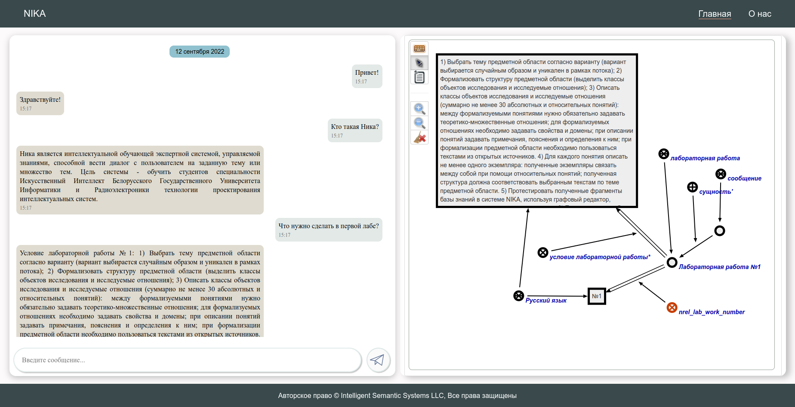

<h1 align="center">Welcome to NIKA 👋</h1>
<p>
  <a href="https://www.gnu.org/licenses/gpl-3.0.html" target="_blank">
    
  </a>
</p>

> **N**IKA is an **I**ntelligent **K**nowledge-driven **A**ssistant

## About
NIKA is an ostis-system designed with [OSTIS Technology principles](https://github.com/ostis-ai) in mind. 

You can learn more about it by asking the assistant: "What's NIKA?"

## Run documentation

```sh
#Terminal
cd nika
pip3 install mkdocs markdown-include mkdocs-material mkdocs-i18n
mkdocs serve
```

Then open http://127.0.0.1:9001/ in your browser

## ✨ Demo



# Requirements
* A computer with Windows 10/11, macOS (10.15+), or Linux (Ubuntu/Debian/Fedora-like).
* Internet access.
* Administrator rights (Windows) or sudo rights (Linux/macOS) for installing programs.
* You will need Docker (with the Compose plugin) installed and operational on your machine.
* A little patience — it takes time to install Git, WSL, Docker and download images (10-60 minutes, depending on the Internet speed).

# 0. General training

### Windows
  * PowerShell (launched as an administrator).
  * WSL (Windows Subsystem for Linux, Windows only) — is a special feature in Windows that allows you to use a Linux environment inside Windows.

### MacOS/Linux
  * Terminal.

### General
 
* Git — is a system for downloading source code (repositories).
* Docker — is a program that runs "containers" (as small virtual machines).

# 1. Installing Git

### Windows
1. Open a browser, go to the Git for Windows [website](https://git-scm.com/download/win) and download the installer.
2. Start the installer → press Next until the end → Install.
3. Restart your computer for the changes to take effect.
4. After restarting, open PowerShell and execute:
```
git --version
```
You should see something like:
```
git version 2.x.x
```
5. Windows has a path length limitation that may break cloning large repositories. Enable support for long paths:
```
reg add "HKLM\SYSTEM\CurrentControlSet\Control\FileSystem" /v LongPathsEnabled /t REG_DWORD /d 1 /f
```
6. Then configure Git to work correctly with long filenames:
```
git config --system core.longpaths true
```
After that Git will work correctly with long filenames and deep folder structures.
### macOS
Open the Terminal (Launchpad → Terminal) and enter:
```
git --version
```
If Git is not installed, macOS will automatically offer to install "Command Line Tools". Agree and wait for installation.

### Linux (Ubuntu/Debian)
In the terminal:  
Update the list of available packages
```
sudo apt update
```
Install Git
```
sudo apt install -y git
```
Check the installed Git version
```
git --version
```
Expected output:
```
git version 2.x.x
```
# 2. Installing Docker
Important: On Windows, Docker Desktop requires WSL2.

### Windows (Docker Desktop + WSL2)

1. Download Docker Desktop for Windows from the [official website](https://docs.docker.com/desktop/install/windows-install/) and install it.
2. During installation, make sure Use WSL 2 based engine is checked.
3. Enable WSL2 (PowerShell launched as Administrator):
```
wsl --install
```
This installs the WSL2 kernel and the default Linux subsystem.

4. Restart your computer for the changes to take effect.  
5. After restart, verify WSL:
```
wsl -l -v
```
You should see your Linux distribution with the status VERSION 2 (WSL2):
```
  NAME      STATE    VERSION
  Ubuntu    Running  2

```
If VERSION is 1, switch to WSL2:
```
wsl --set-version Ubuntu 2
```
6. Start Docker Desktop → wait until it fully starts.
7. Check Docker:
```
docker version
```
Expected output contains:
```
Client:
 Version: 28.x.x
 ```

### macOS

1. Download Docker Desktop for Mac from the [official website](https://docs.docker.com/desktop/install/mac-install/).
2. Drag the Docker icon into Applications.
3. Start Docker → wait until it says Running.
4. Verify installation:
```
docker version
```
### Linux (Ubuntu/Debian, example)

1. Download Docker Desktop [DEB Package](https://desktop.docker.com/linux/main/amd64/docker-desktop-amd64.deb?utm_source=docker&utm_medium=webreferral&utm_campaign=docs-driven-download-linux-amd64)
2. Install the package using apt:
```
sudo apt-get update
sudo apt-get install ./docker-desktop-amd64.deb
```
3. Start Docker Desktop:
```
systemctl --user start docker-desktop
```
4. Signing in with Docker Desktop. Docker Desktop for Linux uses pass (the standard Linux password manager) to store credentials in GPG-encrypted files. Before signing in to Docker Desktop with your [Docker ID](https://docs.docker.com/accounts/create-account/), you must initialize pass. Docker Desktop displays a warning if pass is not configured.
* Generate a GPG key. You can initialize pass by using a gpg key. To generate a gpg key, use the command:
```
gpg --generate-key
```
* Enter your name and email once prompted.
Once confirmed, GPG creates a key pair. Look for the pub line that contains your GPG ID, for example:
```
pubrsa3072 2022-03-31 [SC] [expires: 2024-03-30]
 3ABCD1234EF56G78
uid          Molly <molly@example.com>
```
* Copy the GPG ID and use it to initialize pass. For example:
```
pass init 3ABCD1234EF56G78
```
* You should see output similar to:
```
mkdir: created directory '/home/molly/.password-store/'
Password store initialized for <generated_gpg-id_public_key>
```
5. After you’ve successfully installed Docker Desktop, you can check the versions of these binaries by executing the following commands:
```
docker compose version
```
Expected(example): 
```
Docker Compose version v2.39.4
``` 
Next step:
```
docker --version
```
Expected(example):
```
Docker version 28.4.0, build d8eb465
```
Next step:
```
docker version
```
Expected(example):
```
Client:
 Version:           28.4.0
 API version:       1.51
 Go version:        go1.24.7
<...>
```
To enable Docker Desktop to start on sign in, from the Docker menu, select Settings → General → Start Docker Desktop when you sign in to your computer:
```
systemctl --user enable docker-desktop
```
To stop Docker Desktop, select the Docker menu icon to open the Docker menu and select Quit Docker Desktop:
```
systemctl --user stop docker-desktop
```

# 3. NIKA repository cloning (general)

The last verified stable version of NIKA is 0.1.0. To ensure compatibility with the published Docker images, we will checkout the verified commit for this version in the next step.   
Open PowerShell / Terminal in a working folder, e.g.:
* Windows:
```
C:\Users\YourName\Projects
```
* macOS/Linux:
```
~/project
```
Download (clone) the NIKA repository with safe Windows settings.  
Then execute:  
```
git clone -c core.longpaths=true -c core.autocrlf=true https://github.com/ostis-apps/nika
```

Go to the NIKA project directory
```
cd nika
```

Checkout the verified stable revision
```
git checkout 69858165c3b5fb26ca783950c74bfe7bddd64a00
```

Download all submodules used in the project
```
git submodule update --init --recursive
```

Every command is necessary — do NOT skip.
# 4. Launch (general)
Pull the images (download all required Docker images).  
Inside the nika directory:
```
docker compose pull
```
Start the containers:
```
docker compose up --no-build
```

# 5. Checking services
After all containers start, open in your browser:
* [UI (dialogue)](http://localhost:3033)
* [SC-web (visualization)](http://localhost:8000)
* Problem-solver: port 8090 (service only, no webpage)

If UI and SC-web open — everything is working.

# Useful commands & Troubleshooting

All commands below must be executed inside the nika directory.

Check containers status
```
docker compose ps
```

Use when:
* UI on port 3033 does not open
* You want to verify that containers are started and healthy

Start the project
```
docker compose up --no-build
```
Stop the roject
```
docker compose down
```

Use when:
* Docker containers are not running
* You need a clean restart of the project

View last 200 lines of logs for a specific service
```
docker compose logs --tail 200 <service name>
```
Example:
```
docker compose logs --tail 200 nika-ui
```
Use when:
* UI does not open
* A service fails to start
* You need error details

Restart a specific service
```
docker compose restart <service>
```
Use when:
* One service is stuck or misbehaving
* Full project restart is not required

Get inside a running container
```
docker exec -it <container name> bash
```

Use when:
* Manual inspection or debugging inside a container is required
* Common problems and solutions

Problem: docker compose is not available.  
Solution: Try the older command 
``` 
docker-compose
```

Problem: Docker images download extremely slowly.  
Solution: Wait. Check your internet speed. Perform a 
```
docker compose pull
``` 
separately; see error output.

Problem: Git clone fails with long path errors.  
Solution: Follow the Step 3 and clone it again.

Problem: UI on port 3033 not opening.  
Solution: Make sure that Docker containers are active
```
docker compose ps
```
 View logs 
 ```
 docker compose logs nika-ui
 ```

Problem: Docker permissions error (Linux).  
Solution: Add the user to the docker group
 ```
 sudo usermod -aG docker $USER
 ```
 Then log out and log in.

## 🤝 Contributing

Contributions, issues and feature requests are welcome!<br />Feel free to check [issues page](https://github.com/ostis-apps/nika/issues). 

## 📝 License

This project is [GPLv3](https://www.gnu.org/licenses/gpl-3.0.html) licensed.
